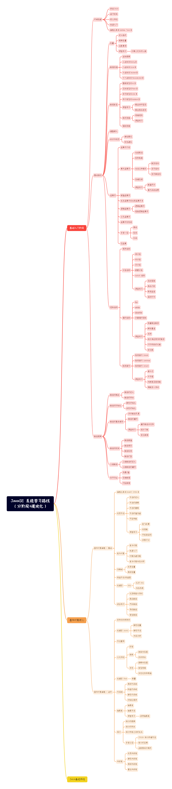

## 📚 项目简介
这是我个人整理的 JavaSE 系统学习路线笔记 

采用"理论 + 实践 + 复盘"的学习模式，系统掌握 Java 核心技术。

## 🎯 费曼学习法

### 💡 核心原则
用简单的语言教会别人 → 证明自己真正理解

### 🔄 四步循环
1. **选择** - 锁定学习目标
2. **讲解** - 模拟教学场景
3. **修补** - 发现知识漏洞
4. **简化** - 提炼核心要点

## 🗺️ 学习路线思维导图
